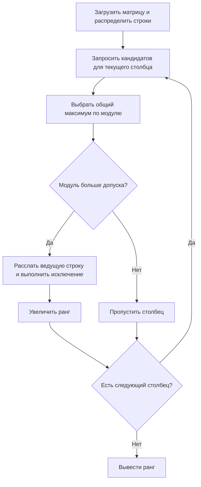

# Отчёт по лабораторной работе 1

**Студент:** Стасев Б.В.  
**Группа:** ИТП-41  
**Проверяющий:** ассистент Башаримов Ю. С.  
**Вариант:** 1 — ранг квадратной матрицы N×N  
**Тема:** стек протоколов TCP/IP и передача данных по сети

## Цель и реализация

Приложение C# / .NET 8 передаёт данные по TCP/IP и распределяет вычисление численного ранга квадратной матрицы между тремя рабочими узлами. Координатор читает и проверяет матрицу, распределяет строки циклически, собирает ведущие элементы и синхронизирует исключение методом Гаусса.

Рабочие узлы находят максимум по модулю в текущем столбце среди ещё не выбранных строк. Координатор выбирает общий максимум, при равенстве — меньший исходный номер строки. Если элемент не превышает допуска, пропускается только текущий столбец; более поздние столбцы могут быть ненулевыми. Иначе ведущая строка передаётся всем узлам, они выполняют исключение, а ранг увеличивается на 1. Последовательный метод использует тот же порядок выбора.



## Сетевой обмен

Соединения TCP, порт координатора 5000. Сообщения — UTF-8 JSON, по одному объекту на строку. `hello` сообщает идентификатор и ОС worker; `init` передаёт строки, `ready` подтверждает готовность; `findPivot` запрашивает локального кандидата; `eliminate` передаёт ведущую строку, `ack` подтверждает обработку; `stop` завершает узлы. На каждом шаге координатор ждёт все ответы.

## Проверка корректности

Матрица 4×4:

```text
1 2 3 4
2 4 6 8
0 1 0 1
0 0 1 1
```

Ранг равен 3: вторая строка зависит от первой, а первая, третья и четвёртая независимы. Локальная и распределённая программы получили ранг 3; фактический вывод — в `evidence/logs/sample.out`.

Пройдены 26 интеграционных проверок: 21 расчёт через TCP сравнивался с точным рангом, найденным на рациональных числах, и 5 проверок некорректного ввода. Включены нулевые столбцы, зависимые строки, нулевая и единичная матрицы, случайные целочисленные матрицы и разное число узлов. Код — `tests/check_rank.py`.

## Методика измерения

На одном ПК с AMD Ryzen 7 5700X и Windows 11 Pro проверены три конфигурации. Windows использует .NET Runtime 8.0.28; Linux-контейнеры — Debian 12 и .NET Runtime 8.0.31; Docker Engine — 29.6.1. В каждой конфигурации три рабочих узла.

Для одинакового входа `matrix-benchmark-64.txt` используется матрица I + J: на диагонали 2, вне диагонали 1. Собственные значения 65 и 1, ранг 64. Оба режима выполняют один прогрев и пять измеряемых повторений. В таблице среднее время. Запуск процессов и подключение исключены, распределённое время включает передачу исходных строк и вычисление. Отдельные замеры и платформы — в `evidence/results/*.json`.

| Среда | Ранг | Локально, мс | Распределённо, мс | Ускорение |
|---|---:|---:|---:|---:|
| Windows, 3 процесса | 64 | 0.081 | 36.045 | 0.0022 |
| Linux, 3 контейнера | 64 | 0.120 | 51.906 | 0.0023 |
| Windows master и 3 Linux workers | 64 | 0.104 | 104.235 | 0.0010 |

Во всех случаях локальный и распределённый ранги совпали и равны 64. Все рабочие узлы завершились без ошибок. Смешанный режим подтверждает взаимодействие Windows и Linux через `host.docker.internal`.

## Анализ и вывод

Распределённое вычисление оказалось медленнее локального во всех трёх конфигурациях. На небольшой матрице время передачи JSON, сетевых раундов и синхронизации превышает время арифметической работы. Локальная сложность — O(N³) по времени и O(N²) по памяти; распределение строк сокращает арифметическую работу worker, но сохраняет последовательность шагов и добавляет обмен данными.

Пять повторений после одного прогрева не устраняют полностью влияние JIT, фоновой нагрузки и планирования процессов. Эти результаты характеризуют данный эксперимент, а не преимущество одной ОС. Ранг численный и зависит от допуска при плохо обусловленных данных.

Три контейнера на одном ПК моделируют отдельные сетевые узлы. Проверка на трёх физических компьютерах не выполнялась; команды для неё приведены в README. Для оценки ускорения нужно повторить замеры на одинаковых физических узлах и увеличить размер матрицы.

Разработано работающее кроссплатформенное TCP/IP-приложение для варианта 1. Корректность подтверждена точным эталоном и совпадением результатов локального, Windows, Linux и смешанного запусков. Полный листинг, блок-схема и фактический вывод включены в отчёт DOCX.
